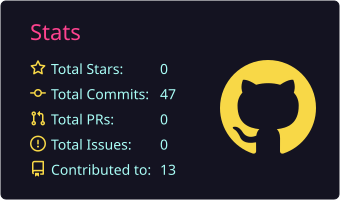
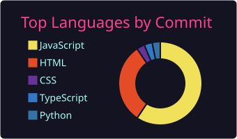
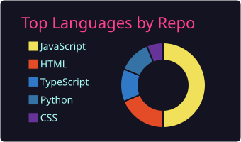
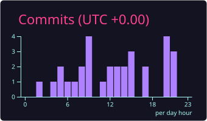

<div align="center">


<a href="https://git.io/typing-svg">
  
</a>

<br/>

[](https://www.linkedin.com/in/naman-sharma-09a32924b/)
[](mailto:naman.sh.fzd@gmail.com)
[](https://github.com/Naman-Sharma123)


</div>

---

## 👨‍💻 About Me

I'm a **Full Stack Developer** with hands-on experience building responsive, production-style web apps. My strength is the **frontend (React, Next.js, JavaScript)**, and I'm steadily growing on the **backend (Node.js, FastAPI, PostgreSQL, Redis)**.

```js
const naman = {
  role: "Full Stack Developer",
  stack: ["React", "Next.js", "Node.js", "FastAPI"],
  databases: ["PostgreSQL", "MySQL", "Redis"],
  based: "Delhi NCR, India 🇮🇳",
  funFact: "I design in Figma before I code in React 🎨",
};
```

### 🎯 What I'm up to

<div align="center">


</div>

```bash
naman@dev:~$ cat goals.md

  looking for   →  Full Stack / React Developer role (remote or Delhi NCR) 🟢
  ask me about  →  React, Figma-to-code, REST APIs, getting started with full stack

naman@dev:~$ _
```

## 🛠️ Tech Stack

### 🎨 Frontend


### ⚙️ Backend


### 🗄️ Databases & Caching


### 🧩 Languages


### ☁️ Cloud, DevOps & Tools


### 🤖 Data & AI


### 🎨 Design


---

## 🧠 Core Skills

| Area | What I work on |
|------|----------------|
| **Frontend Development** | Reusable React / Next.js components, hooks, state management, responsive UI |
| **Backend Development** | REST APIs with Node.js & FastAPI, authentication, database integration |
| **Databases & Caching** | PostgreSQL / MySQL schema design and queries, Redis for caching |
| **Problem Solving** | DSA in Java: arrays, strings, recursion, trees, and more |
| **AI / GenAI** | Experimenting with LLMs and AI-powered features |
| **UI / UX** | Wireframing and prototyping in Figma, polished interfaces |
| **Version Control** | Git & GitHub workflows, branching, pull requests |

---

## 📊 GitHub Stats

<div align="center">








</div>

---

## 🤝 Let's Connect

I'm currently **open to Software Developer opportunities** (Full Stack / React): remote, or on-site in **Delhi NCR**. If you're hiring or want to collaborate, reach out!

📫 **Email:** [namansh7022@gmail.com](mailto:namansh7022@gmail.com)
💼 **LinkedIn:** [naman-sharma](https://www.linkedin.com/in/naman-sharma-09a32924b/)

<div align="center">


</div>
